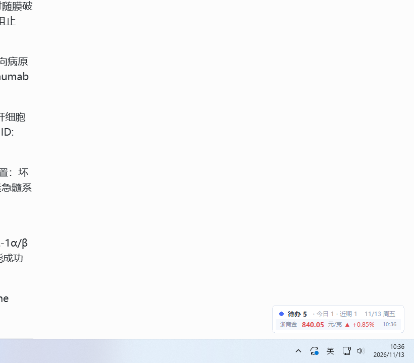
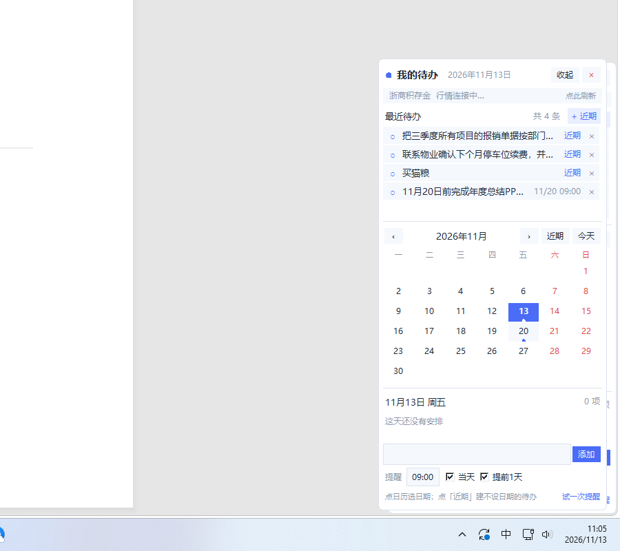
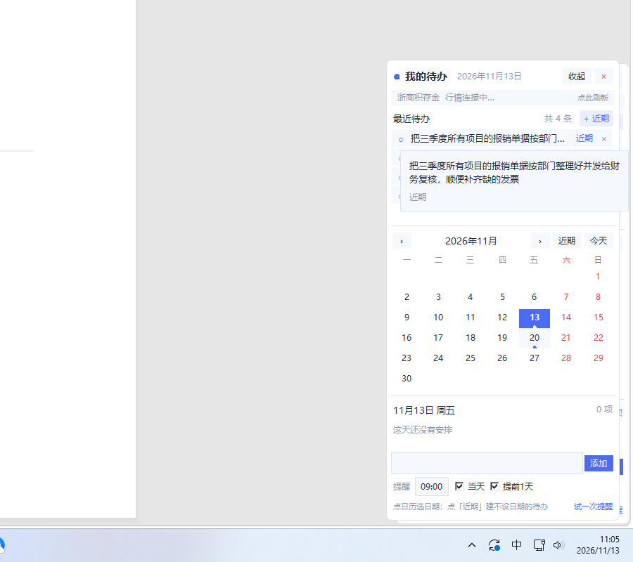

# TodoDock · 待办胶囊

> 桌面右下角常驻的小胶囊：点开是最近待办 + 月历，日历上直接建待办，到期当天与提前一天弹窗提醒；折叠态第二行实时显示浙商银行积存金价格。


**运行时零第三方依赖**，只用 Python 标准库（`tkinter` / `urllib` / `json` / `threading`）；数据全部存在本机 `data.json`，不上传任何服务器。

---

## 界面一览

| 折叠态胶囊 | 展开态面板 |
| :---: | :---: |
|  |  |

折叠胶囊第二行是实时金价，**涨红跌绿**（A 股习惯），每 5 秒刷新：

| 涨（红） | 跌（绿） |
| :---: | :---: |
|  |  |

长标题悬停 0.3 秒会弹出全文气泡，右侧日期标签不会被挤掉：



---

## 功能特性

- **右下角胶囊**：像输入法状态栏一样常驻、可拖动、位置自动记住；点开面板，点面板外自动收回。
- **两类待办**
  - *日期待办*：绑定到具体日期，日历上该日带蓝点。
  - *近期待办*：不绑定任何日期、不提醒，随手记「买猫粮」这类事。
- **月历**：可翻月，今天浅蓝、选中日深蓝；点某天 → 输入框回车，即给那天建待办。
- **提醒**：每条可设提醒时刻（默认 09:00），「当天」「提前 1 天」两个开关独立控制；到点弹置顶提醒窗 + 系统提示音，可一键「标记完成」。开机晚了 20 小时内补发一次，已提醒过的不会重复弹。
- **长标题友好**：按真实像素宽度裁剪，悬停显示全文；提醒弹窗里的长标题自动换行、不截断。
- **实时金价**：折叠胶囊与展开面板都显示浙商银行积存金实时价、涨跌幅与报价时间；后台线程取数不卡界面，点金价行可立即刷新，断网保留上次报价并标 `*`。
- **热加载**：命令行改完 `data.json`，挂件约 0.3 秒自动刷新，无需重启。
- **数据安全**：读取失败绝不回退成空数据（否则一次保存就会抹掉全部待办）；写入用临时文件 + 原子替换；界面删除会留备份。

---

## 快速开始

### 方式 A：直接下载 exe（无需 Python，推荐）

1. 到 [Releases](../../releases/latest) 下载 `TodoDock-v1.0.0-win64.zip`。
2. 解压到任意目录，双击 `TodoDock.exe`。
3. 右下角出现小胶囊即成功。想完全离线，可用 `TodoDock.exe --nogold` 启动。

> 首次运行会在 `%USERPROFILE%\.workbuddy\todo-widget\` 下创建 `data.json`。
> 想让数据跟着 U 盘走：在 exe 同目录放一个空的 `portable.txt`，数据就会写到 exe 同目录的 `data\` 子目录；也可用 `--data-dir <路径>` 显式指定。

**开机自启**：`Win + R` 输入 `shell:startup`，把 `TodoDock.exe` 的快捷方式放进去即可。

### 方式 B：源码运行

要求 Python 3.9+ 且带 `tkinter`（Windows / macOS 官方安装包自带；部分 Linux 需要 `sudo apt install python3-tk`）。

```bash
git clone https://github.com/<your-username>/todo-dock.git
cd todo-dock
python src/todo_dock.py            # 启动胶囊
```

关闭：点面板右上角 `×`，或 `python src/todo.py stop`。

---

## 界面操作

| 操作 | 做法 |
| --- | --- |
| 展开 / 收回 | 点折叠胶囊；点面板外或「收起」收回 |
| 建日期待办 | 点日历某天 → 底部输入框输入 → 回车 |
| 建近期待办 | 点「近期」或「+ 近期」→ 底部输入框输入 → 回车 |
| 完成 / 删除 | 每条左边 `○` 点一下完成，右边 `×` 删除 |
| 看长标题全文 | 鼠标停在被截断的标题上约 0.3 秒 |
| 验证提醒 | 面板右下角「试一次提醒」 |
| 立即刷新金价 | 点金价那一行 |
| 移动位置 | 拖动胶囊或面板标题栏 |

更完整的图文说明见 [docs/使用说明.html](docs/使用说明.html)。

---

## 命令行工具

`src/todo.py` 用于批量管理待办，改完数据挂件会自动刷新。

```bash
python src/todo.py add "买猫粮"                             # 近期待办（不设日期、不提醒）
python src/todo.py add "交房租" --due 2026-11-16 --time 09:00 --remind both
python src/todo.py setdue 3 2026-11-20 --time 14:00      # 改期后提醒重新生效
python src/todo.py setdue 3 none                         # 去掉日期，变回近期待办
python src/todo.py list --full --all                     # 长标题不截断、连已完成一起看
python src/todo.py gold                                  # 单查一次实时金价
python src/todo.py done <匹配词>                         # 完成（归入已完成）
python src/todo.py remove <匹配词>                       # 删除
python src/todo.py status                               # 运行状态、数据位置
python src/todo.py start / stop                          # 启动 / 关闭挂件
python src/todo.py autostart on|off|status               # 开机自启
```

`<匹配词>` 支持待办编号、`id` 前缀、或标题中唯一的一段文字。
`--remind` 取值：`both`（默认，当天+提前一天）/ `day`（只当天）/ `eve`（只提前一天）/ `none`。

完整字段说明见 [docs/data-format.md](docs/data-format.md)。

---

## 数据来源与免责声明

金价取自京东金融平台「浙商银行积存金」的公开 H5 报价接口：

```
GET https://api.jdjygold.com/gw2/generic/jrm/h5/m/stdLatestPrice?productSku=1961543816
```

返回最新价、涨跌幅、涨跌额、昨收与报价时间，无需登录或密钥。这是**渠道实时报价，不是银行柜面成交价**，仅适合看趋势，实际交易请以浙商银行 App / 网点报价为准。本项目与浙商银行、京东金融均无关联。

联网只发生在这一个接口上；`--nogold` 可完全关闭网络请求。除此之外程序不访问网络、不收集任何数据。

---

## 从源码构建 exe

```bash
pip install -r requirements-build.txt
python build_exe.py
# 产物：dist/TodoDock.exe
```

详见 [docs/BUILD.md](docs/BUILD.md)。仓库附带 GitHub Actions 配置示例 `docs/ci-build.yml.example`：把它复制到 `.github/workflows/build.yml` 即可启用 CI，之后推送 `v*` 标签会自动构建并发布 Release。（首次发布用的 PAT 未勾选 `workflow` 权限，故 CI 以示例文件形式提供，不影响 exe 与源码使用。）

---

## 项目结构

```
todo-dock/
├── src/
│   ├── todo_dock.py       # 主程序：胶囊 / 月历 / 提醒 / 金价（仅标准库）
│   ├── todo.py            # 命令行管理工具
│   └── todo_float.py      # 旧版进度条悬浮窗（兼容旧数据，不推荐）
├── assets/                # 图标、使用说明
├── docs/                  # 使用说明、数据格式、构建文档、CI 配置示例
├── screenshots/           # README 截图
├── build_exe.py           # 一键构建脚本
├── CHANGELOG.md
├── CONTRIBUTING.md
├── LICENSE
└── README.md
```

程序与命令行共用数据目录 `%USERPROFILE%\.workbuddy\todo-widget\`（可用环境变量 `TODO_WIDGET_HOME` 覆盖）。

---

## 常见问题

**Q：双击 exe 没反应？**
先确认没有已运行的实例（旧实例会占住单实例锁）。查看 `%USERPROFILE%\.workbuddy\todo-widget\dock.log`，打包版启动异常会弹窗提示并写入日志。

**Q：改了代码，运行中的窗口没变化？**
`data.json` 支持热加载，程序代码不支持。需要 `python src/todo.py stop` 后重新 `start`，或重启 exe。

**Q：提醒没弹？**
提醒依赖常驻运行，请开启开机自启；检查该条待办的「当天 / 提前1天」是否勾选、时刻是否已过（超过 20 小时的触发点不再补发）。

**Q：macOS / Linux 能用吗？**
核心功能可用；圆角透明窗口效果依赖 Windows 的 `-transparentcolor`，其他平台自动降级为方角。预编译 exe 仅提供 Windows 版。

---

## 许可证

[MIT](LICENSE) © 2026 TodoDock contributors
